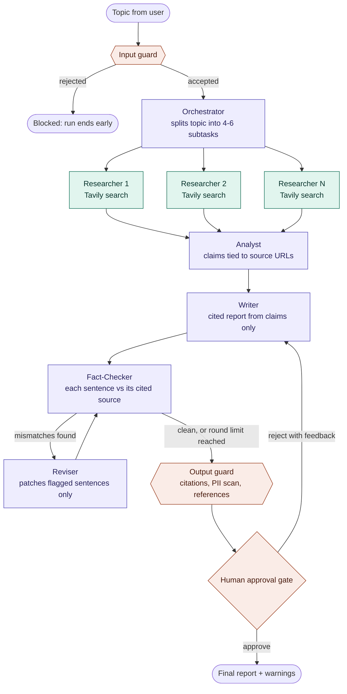

# Agentic Research Assistant

A multi-agent system that researches a topic on the live web and delivers a **cited, fact-checked report**, with a human approval gate before anything is finalised. Built with LangGraph.

Writing a comprehensive report by hand takes hours, and a single LLM call lacks depth, cross-referencing, and trustworthy citations. This project splits the job across specialised agents. Each has one responsibility and produces output that the next step can check.

## What it does

- Breaks a topic into 4-6 focused research questions
- Searches the web for each question **in parallel** (Tavily)
- Extracts atomic claims, each tied to the exact source URL it came from
- Writes a structured report using *only* those claims, with `[n]` citations
- Fact-checks every sentence against the source it cites, and patches only the sentences that fail
- Pauses for human approval; rejecting with feedback sends the draft back to the writer
- Screens the input topic, scraped web content, and the final output with guardrails

## Workflow



Purple nodes are LLM agents, green nodes are tool steps with no LLM, and orange nodes are guardrails or the human gate. All nodes read and write one shared LangGraph state (`AppState`).

## Agents and nodes

| Node | Type | Responsibility |
|---|---|---|
| `input_guard` | Guard | Checks topic length and prompt-injection patterns, then asks an LLM whether it is a legitimate research topic. Stops bad requests before any search is spent. |
| `orchestrator` | LLM | Splits the topic into 4-6 distinct, searchable subtasks. |
| `researcher` x N | Tool | One Tavily search per subtask, run in parallel with LangGraph `Send`. No LLM involved. |
| `analyst` | LLM | For each subtask, extracts up to 8 atomic claims with their source URL. Drops any claim whose URL was not retrieved for that subtask. |
| `writer` | LLM | Writes the structured report from the claims only. On rejection, rewrites using the reviewer's feedback. |
| `fact_checker` | LLM | Compares each sentence with the source it cites. Flags changed numbers, dropped time frames or scope, and uncited facts. |
| `reviser` | LLM | Rewrites only the flagged sentences and patches them into the draft. Stops after a bounded number of rounds. |
| `output_guard` | Guard | Validates citation numbers, scans for contact details, rebuilds the reference list in code, and attaches warnings. |
| `human_gate` | Human | Pauses with `interrupt()`, shows the draft, warnings, and unresolved issues, and resumes on approve or reject. |

## Design decisions

- **Claims flow downstream, not raw text.** The writer never sees web pages. Every fact in the report traces back to a claim bound to a URL.
- **Verification targets the final draft.** Facts drift at the writing stage (qualifiers like "by 2030" quietly disappear), so the fact-checker compares the finished sentences with their cited sources.
- **Surgical repairs.** The reviser patches only flagged sentences instead of regenerating the report. That is cheaper, keeps correct text stable, and the loop is bounded.
- **References are built in code.** The model never writes the URL list, so it cannot alter or invent a source.
- **Web content is untrusted.** Scraped text is whitespace-cleaned and capped, wrapped in tags the analyst treats as data, and pages containing instruction-injection phrases are skipped.
- **Pause and resume.** LangGraph `interrupt()` plus a checkpointer stores state under a `thread_id`, so a review can happen later and resume where the graph stopped.

## Getting started

```bash
git clone https://github.com/NikhilAmbure/Agentic-Research-Assistant.git
cd Agentic-Research-Assistant
python -m venv venv && source venv/bin/activate   # Windows: venv\Scripts\activate
pip install -r requirements.txt
cp .env.example .env    # then fill in OPENAI_API_KEY and TAVILY_API_KEY
python test.py
```

`test.py` runs the full graph in the terminal. When it reaches the approval gate it prints the draft, the warnings, and the unresolved issues:

```
approve / reject? reject
Feedback: Shorten the executive summary to 3 sentences
```

A rejection triggers a rewrite and a fresh fact-check, then returns you to the gate. Approving ends the run.

To drive the graph from your own code:

```python
from langgraph.types import Command
from agent.graph import graph

config = {"configurable": {"thread_id": "demo-1"}}   # use a fresh id per topic
out = graph.invoke({"topic": "Impact of AI agents on software engineering jobs"}, config)

# The graph is now paused at the gate:
# out["__interrupt__"][0].value -> {"draft", "warnings", "unresolved_issues"}

out = graph.invoke(Command(resume={"action": "approve"}), config)
```

Each run uses roughly 4-6 Tavily searches, so keep the free tier's monthly limit in mind.

## Project structure

```
agent/
  state.py                    # AppState schema shared by every node
  tools.py                    # Tavily search, text cleaning, injection filter
  graph.py                    # nodes, routing, guardrails, graph assembly
Agentic_Research_Assistant/   # Django project (settings, urls, asgi)
chat/                         # Django app, where the REST API will live
test.py                       # interactive CLI runner
```

## Tech stack

Python, LangGraph, LangChain, OpenAI (`gpt-4o-mini`), Tavily Search API, Pydantic, Django and Django REST Framework.

## Roadmap

- [x] Multi-agent graph with parallel web research
- [x] Input, source, and output guardrails
- [x] Sentence-level fact-checking with a surgical revision loop
- [x] Human approval gate with feedback loop
- [ ] REST API (DRF + Celery) with Postgres-backed checkpoints
- [ ] Section-level parallel writing and checking to cut latency
- [ ] Shared memory across runs (Mem0)

## Known limitations

- The fact-checker is an LLM, not ground truth. It verifies against the retrieved snippets, which are capped in length, not against the full web page.
- A run takes a couple of minutes today. Sequential writer and checker calls dominate the time.
- Claims that stay unresolved after the revision rounds are not hidden. They reach the human gate as warnings.